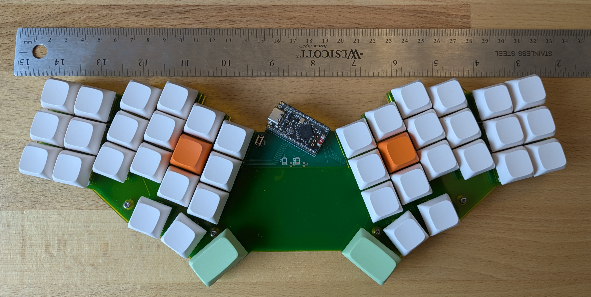
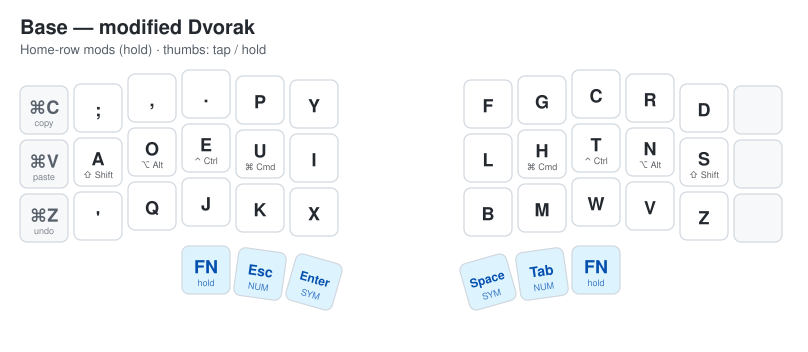
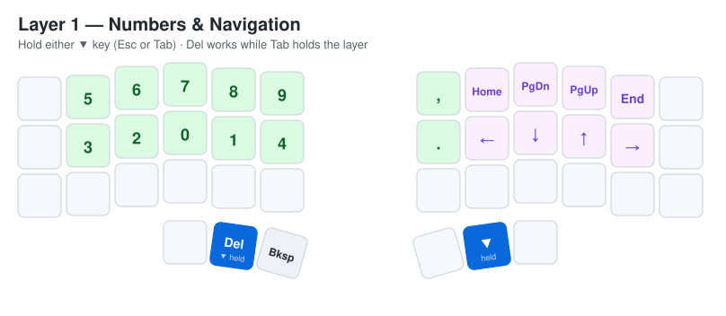
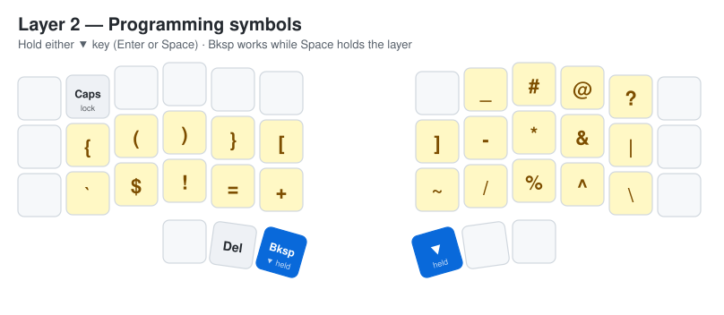
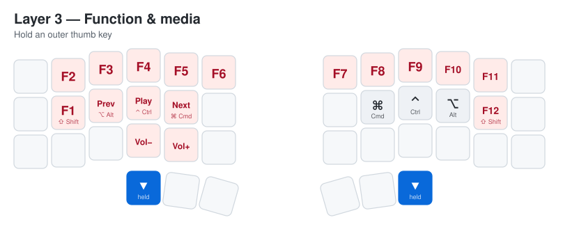
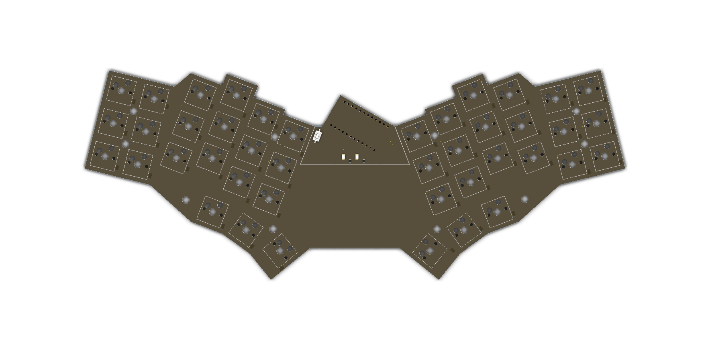
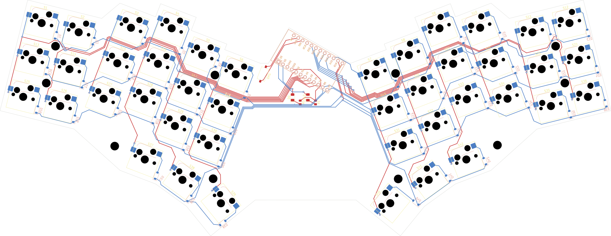
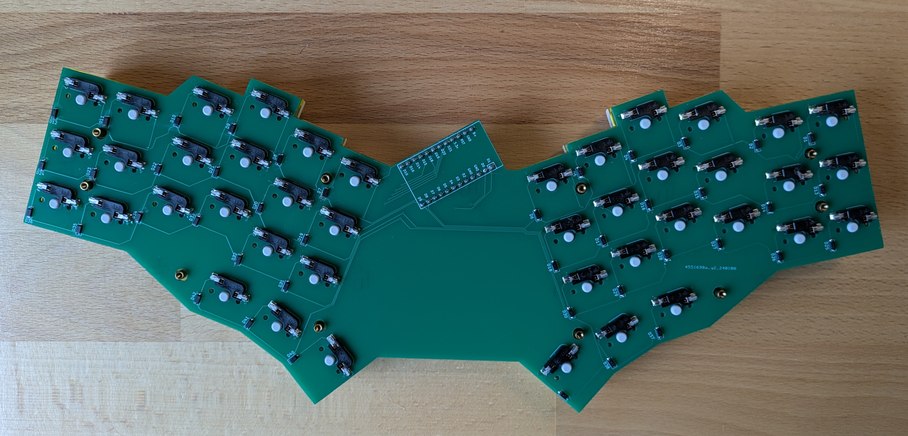
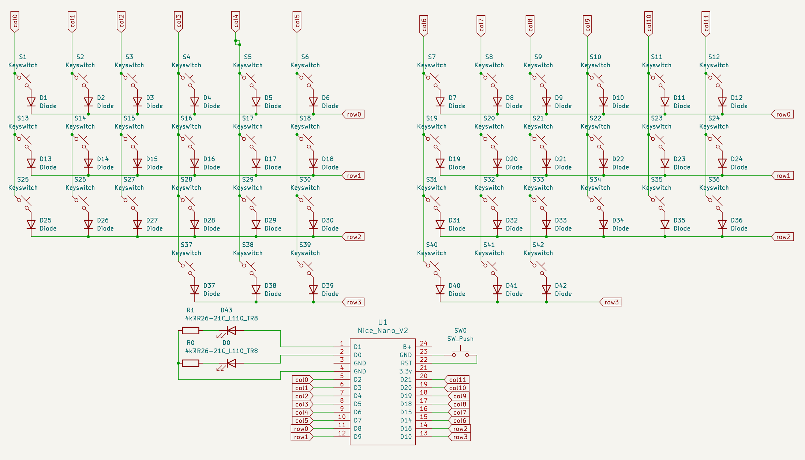
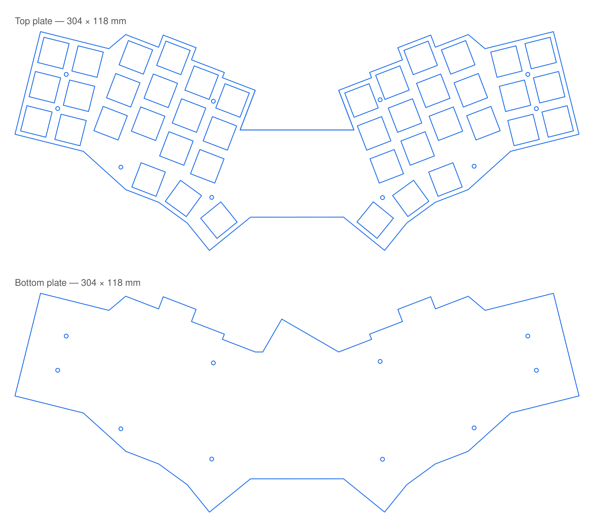

# Cesar 3

**A 42-key ergonomic unibody keyboard, built around a modified Dvorak layout and a layer system designed for programming.**



Cesar 3 is the third iteration of a personal keyboard project. The goal is simple: type and write code all day without straining the hands, wrists or shoulders. Every decision in the design (the splayed key columns, the angled halves, the thumb clusters, the layout and the layers) serves that goal.

---

## Why it's ergonomic

- **Split, angled halves on a single board.** The two hands sit at shoulder-friendly angles, so the wrists stay straight and don't bend outward. It's a unibody, so there's still only one thing to carry and no cable between halves.
- **Column stagger and splay.** Keys follow the natural length of each finger: the middle-finger column sits highest, while the pinky and inner columns drop lower. Each column is also rotated to follow the arc the fingers make when they curl.
- **Fanned thumb clusters.** Each thumb gets three keys arranged on an arc. The thumbs, which do almost nothing on a regular keyboard, now handle Space, Enter, Esc, Tab and all the layer switching.
- **42 keys, no reaching.** With no number row, no function row and no far-away modifiers, every key is at most one row away from home. The rest comes from layers.
- **Home-row modifiers.** Shift, Alt, Ctrl and Cmd sit under the resting fingers (hold `A O E U` / `H T N S`), so shortcuts never need a pinky stretch to the corners.

## Modified Dvorak

The base layer is Dvorak. All the vowels sit on the left home row and the most common consonants on the right, so the hands alternate naturally and the fingers spend most of their time on the home row. A few changes adapt it to this board and to coding:

| Change | Why |
|---|---|
| `;` moved to the top-left and `'` to the bottom-left (swapped vs. standard Dvorak) | `;` is typed far more often than `'` in most languages, so it gets the easier spot |
| `L` and `D` swapped | Puts `L` on the right home row under the index finger |
| `/ = - [ ]` and friends removed from the base layer | They live on the dedicated symbol layer, close to home |
| Left outer column → `⌘C` `⌘V` `⌘Z` | One-key copy, paste and undo |
| Thumb keys are dual-role | Tap for `Esc` / `Enter` / `Space` / `Tab`, hold for a layer |

## Layers

On top of the base layer there are **three layers**, each held from a thumb key, so you never have to remember which layer is "on".

| Layer | Activated by | Contents |
|---|---|---|
| Base | — | Modified Dvorak + home-row mods |
| 1 · Numbers & Navigation | hold `Esc` or `Tab` | Digits on the left, arrows and paging on the right |
| 2 · Programming symbols | hold `Enter` or `Space` | Every bracket, operator and sigil you need for code |
| 3 · Function & media | hold either outer thumb key | `F1`–`F12`, media and volume controls |

### Base



### Layer 1: Numbers & navigation



- The most frequent digits (`0 1 2 3`) sit on the home row under the strongest fingers.
- The arrows go `← ↓ ↑ →` in a single row, the same order as Vim's `h j k l`.
- `Del` and `Backspace` are on the left thumbs, so you can edit while you navigate.

### Layer 2: Programming symbols



This layer was designed for code:

- **Brackets are on the home row as mirrored pairs:** `{ ( ) } [ ]`. Opening and closing a block is a single roll across the fingers.
- **Operators sit together:** `- * & |` on the right home row and `= + ! $` on the left bottom row, so comparisons (`!=`, `==`, `&&`, `||`, `+=`, `->`) are short rolls.
- **Shell and path characters** (`~ / \ % ^ ` # @ ? _`) all sit within one row of home.
- It can be held from **either** thumb, so you can always use the hand opposite the symbol.

### Layer 3: Function & media



- `F1`–`F12` run along the top two rows, with home-row mods still available. This makes IDE shortcuts like `⇧F6` and `⌘F12` easy to reach.
- Previous, Play/Pause and Next are on the left home row, with volume just below.

### Tuning

The full keymap is in [`firmware/config/boards/shields/cesar/cesar.keymap`](firmware/config/boards/shields/cesar/cesar.keymap).


The home-row mods and layer-taps use ZMK's `balanced` hold-tap with **positional hold-trigger** (a mod only activates when the next key is on the opposite hand). They also use a 280 ms tapping term, a 150 ms `require-prior-idle` and a 175 ms quick-tap. Together these stop accidental modifiers while you type fast.

---

## Hardware

|  |  |
|---|---|
| Keys | 42 (36 alpha + 6 thumb); 40 × 1u, 2 × 1.5u |
| Switches | MX-style, hot-swappable (Kailh sockets) |
| Controller | nice!nano v2 (nRF52840), wireless via Bluetooth |
| Firmware | [ZMK](https://zmk.dev), shield `cesar` (in [`firmware/`](firmware)) |
| Matrix | 4 rows × 12 columns, `col2row`, SOD-123 diodes |
| Extras | Reset button, two indicator LEDs |
| Plates | Top (switch) plate + bottom plate, 304 × 118 mm |
| Design tools | KiCad 9 |

### PCB





The finished board from below, with the Kailh hot-swap sockets and SOD-123 diodes soldered on:



### Schematic



### Plates

The top plate holds the switches; the bottom plate closes the case. Both are ready to cut from the DXF files in [`cad/`](cad).



---

## Repository layout

```
cad/                 Top and bottom plate DXF files (laser / CNC ready)
pcb/                 KiCad project: schematic, PCB layout, project settings
firmware/            ZMK user config with the `cesar` shield and keymap
docs/images/         Images used in this README
```

## Building one

1. Order the PCB from the KiCad project in `pcb/` (export Gerbers from KiCad).
2. Cut the two plates from `cad/*.dxf` (acrylic, aluminium or FR4 all work).
3. Solder the 42 SOD-123 diodes, the hot-swap sockets, the reset button, the LEDs and the nice!nano v2.
4. Build the firmware: every push runs the GitHub Actions workflow, which builds `cesar` for `nice_nano_v2`. Download the `.uf2` from the run's artifacts, double-tap reset, and copy it onto the nice!nano.
5. Mount the plates with standoffs, add switches and keycaps.

## License

- **Hardware** (`pcb/`, `cad/`, and the images and documentation in this repository): Copyright (c) 2024 Alexandru Ionita, licensed under the [CERN Open Hardware Licence Version 2 – Strongly Reciprocal](LICENSE) (CERN-OHL-S-2.0). If you distribute a modified version of the design, or products made from one, you must publish your modified source under the same licence.
- **Firmware** (`firmware/`): [MIT](firmware/LICENSE). The ZMK shield files keep their original copyright from the ZMK Contributors.

Source location: https://github.com/nucatus/cesar
